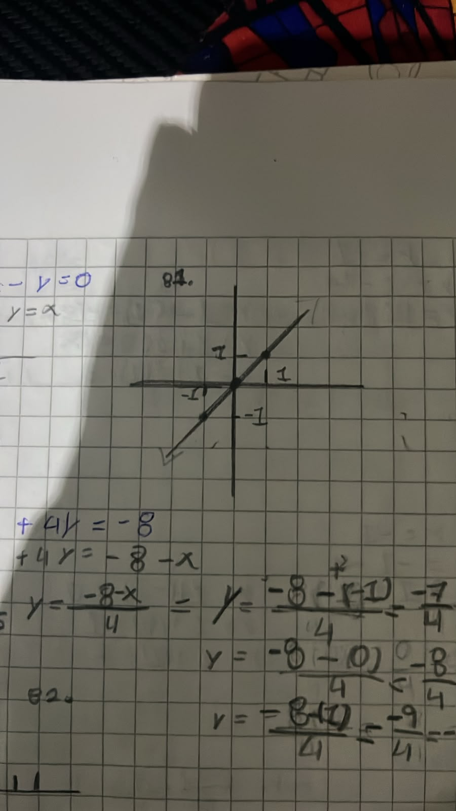
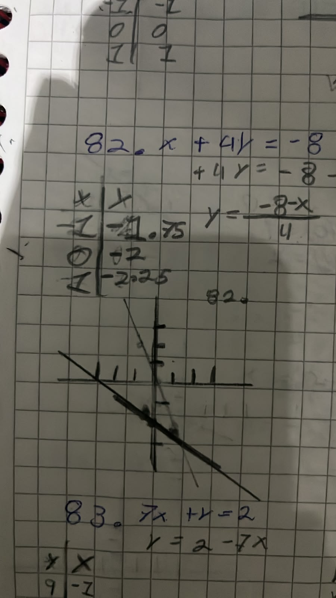
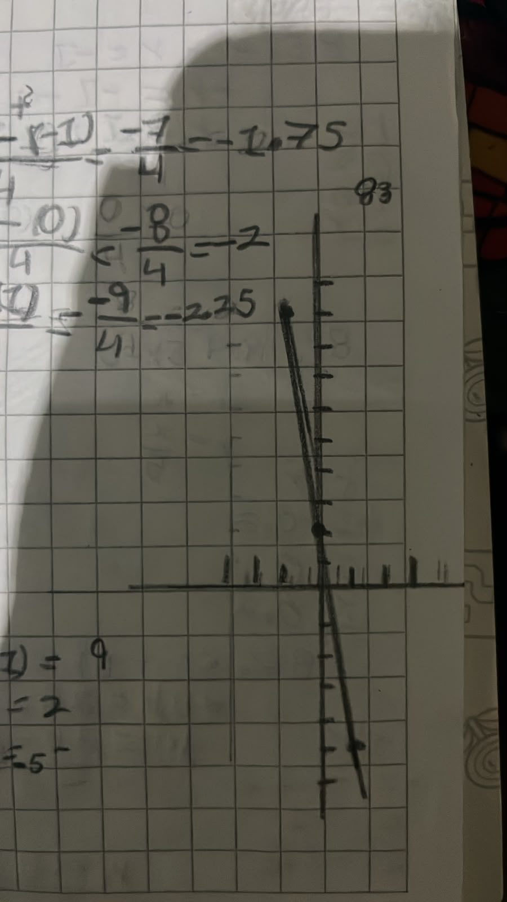
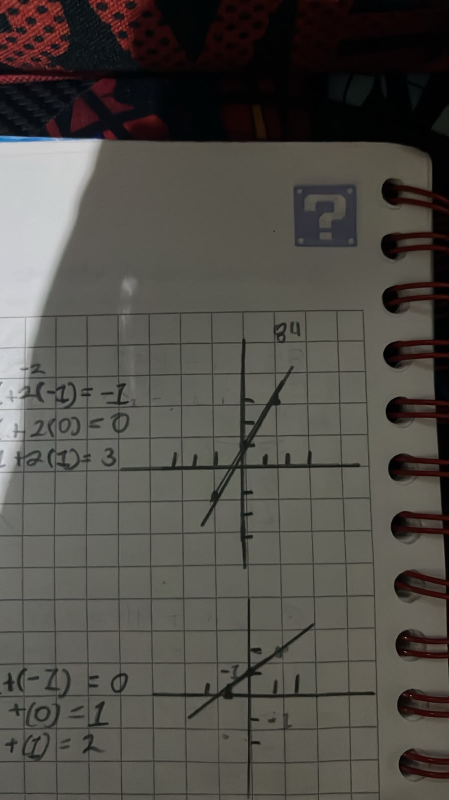
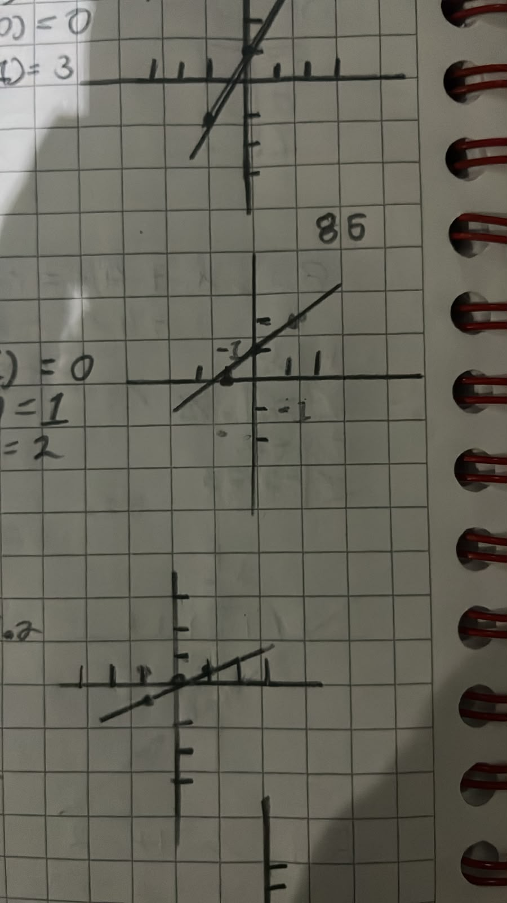
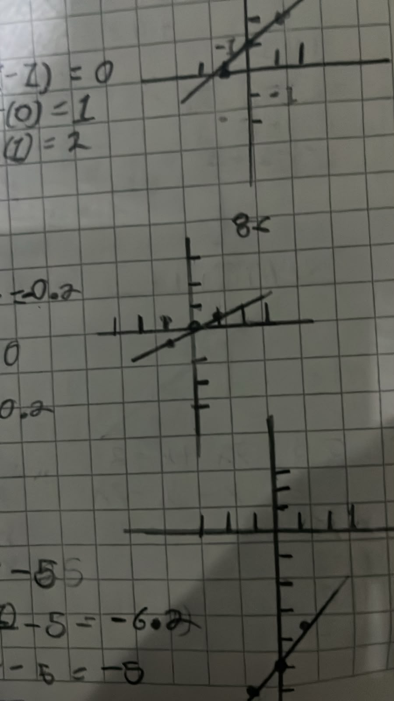
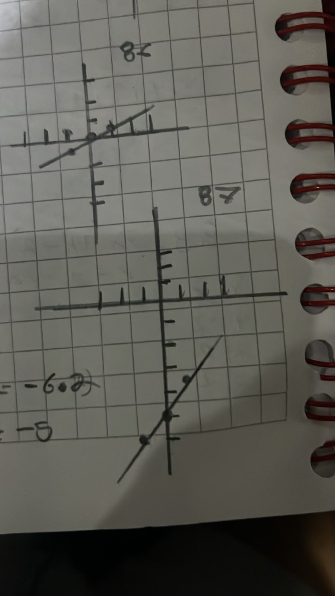
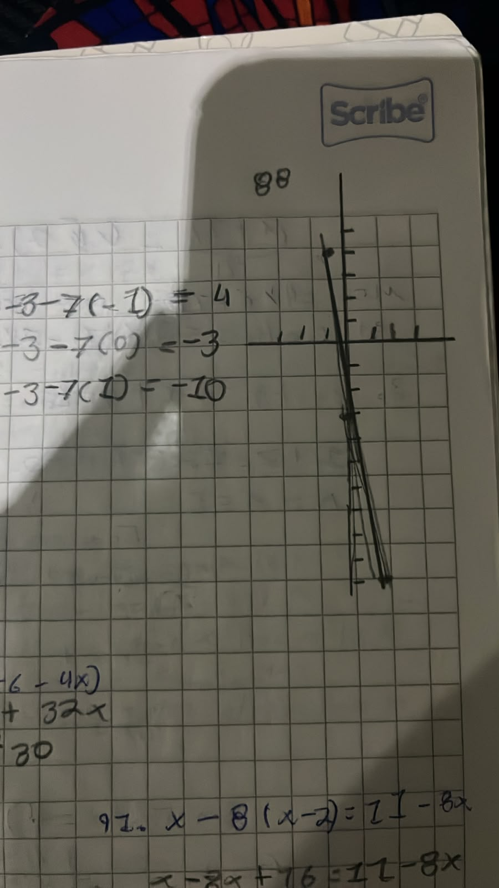

# Unidad 2
## Yuseff Farah
### Grupo 1A Fundamentos de Algebra

**Resuleve los siguientes binomios**

$1)$ $(r-5)^2$

Resultado: $r^2-10r+25$

$2)$ $(7+3r)^2$

Resultado: $49+42r+9r^2$

$3)$ $(4v+5)^2$

Resultado: $16v^2+40v+25$

$4)$ $(7n^2+4)^2$

Resultado: $49n^4+56n^2+16$

$5)$ $(7+p)^2$

Resultado: $49+14p+p^2$

$6)$ $(m+1)^2$

Resultado: $m^2+2m+1$

$7)$ $(8m+3)^2$

Resultado: $64m^2+48m+9$

$8)$ $(6+k)^2$

Resultado: $36+12k+k^2$

$9)$ $(7n+2)(7n-2)$

Resultado: $49n^2-4$

$10)$ $(7m-7)(7m+7)$

Resultado: $49m^2-49$

$11)$ $(2k^3+4)(2k^3-4)$

Resultado: $4k^6-16$

$12)$ $(5x^2-1)(5x^2+1)$

Resultado: $25x^4-1$

$13)$ $(3x-4)(3x+4)$

Resultado: $9x^2-16$

$14)$ $(2n-8)(2n+8)$

Resultado: $4n^2-64$

$15)$ $(4+8x^3)(4-8x^3)$

Resultado: $16-64x^6$

$16)$ $(6+3r)(6-3r)$

Resultado: $36-9r^2$

$17)$ $(8m+8)(8m+5)$

Resultado: $64m^2+104m+40$

$18)$ $(5p+8)(5p+6)$

Resultado: $25p^2+70p+48$

$19)$ $(-5a+5)(-5a-3)$

Resultado: $25a^2-10a-15$

$20)$ $(n-1)(n-2)$

Resultado: $n^2-3n+2$

$21)$ $(-6x-7)(3x-7)$

Resultado: $-18x^2+21x+49$

$22)$ $(3n-2)(-n-2)$

Resultado: $-3n^2-4n+4$

$23)$ $(2n+1)(-8n+1)$

Resultado: $-16n^2-6n+1$

$24)$ $(7v+1)(7v+5)$

Resultado: $49v^2+42v+5$

$25)$ $(y^4+4x)^3$

Resultado: $y^{12}+12xy^8+48x^2y^4+64x^3$

$26)$ $(4x^2+1)^3$

Resultado: $64x^6+48x^4+12x^2+1$

$27)$ $(4x^2+y)^3$

Resultado: $64x^6+48x^4y+12x^2y^2+y^3$

$28)$ $(x-y)^3$

Resultado: $x^3-3x^2y+3xy^2-y^3$

$29)$ $(3m+n)^3$

Resultado: $27m^3+27m^2n+9mn^2+n^3$

$30)$ $(y+4)^3$

Resultado: $y^3+12y^2+48y+64$

$31)$ $(4m+2n^2)^3$

Resultado: $64m^3+96m^2n^2+48mn^4+8n^6$

$32)$ $(y^2-5)^3$

Resultado: $y^6-15y^4+75y^2-125$

**Factoriza los siguientes polinomios**

$33)$ $5n^3+31n^2-28n$

Resultado: $n(5n-4)(n+7)$

$34)$ $42n^2+180n+162$

Resultado: $6(7n+9)(n+3)$

$35)$ $28k^2-260k+288$

Resultado: $4(7k-9)(k-8)$

$36)$ $5n^2+16n+12$

Resultado: $(5n+6)(n+2)$

$37)$ $7p^2-31p+30$

Resultado: $(7p-10)(p-3)$

$38)$ $7x^2+5x$

Resultado: $x(7x+5)$

$39)$ $42x^2+90x-108$

Resultado: $6(7x-6)(x+3)$

$40)$ $7n^2+67n-30$

Resultado: $(7n-3)(n+10)$

$41)$ $24n^2-24n+6$

Resultado: $6(2n-1)^2$

$42)$ $24x^2+216x+486$

Resultado: $6(2x+9)^2$

$43)$ $64m^2-112m+49$

Resultado: $(8m-7)^2$

$44)$ $100n^2+20n+1$

Resultado: $(10n+1)^2$

$45)$ $81x^6-90x^3+25$

Resultado: $(9x^3-5)^2$

$46)$ $147k^6-336k^3+192$

Resultado: $3(7k^3-8)^2$

$47)$ $36a^8-192a^5+256a^2$

Resultado: $4a^2(3a^3-8)^2$

$48)$ $49+28p^3+4p^6$

Resultado: $(7+2p^3)^2$

$49)$ $9x^2-49$

Resultado: $(3x-7)(3x+7)$

$50)$ $4a^2-81$

Resultado: $(2a-9)(2a+9)$

$51)$ $27-147p^2$

Resultado: $3(3-7p)(3+7p)$

$52)$ $250n^2-490$

Resultado: $10(5n-7)(5n+7)$

$53)$ $81k^6-16$

Resultado: $(9k^3-4)(9k^3+4)$

$54)$ $x^6-9$

Resultado: $(x^3-3)(x^3+3)$

$55)$ $25n^6-49$

Resultado: $(5n^3-7)(5n^3+7)$

$56)$ $600a^7-6a$

Resultado: $6a(10a^3-1)(10a^3+1)$

**Factoriza los siguientes polinomios**

$57)$ $125+8x^3$

Resultado: $(5+2x)(25-10x+4x^2)$

$58)$ $64-x^3$

Resultado: $(4-x)(16+4x+x^2)$

$59)$ $125m^3-64$

Resultado: $(5m-4)(25m^2+20m+16)$

$60)$ $-27u^4-64u$

Resultado: $-u(3u+4)(9u^2-12u+16)$

$61)$ $8x^3+27$

Resultado: $(2x+3)(4x^2-6x+9)$

$62)$ $24a+81a^4$

Resultado: $3a(2+3a)(4-6a+9a^2)$

$63)$ $8u^4+27u$

Resultado: $u(2u+3)(4u^2-6u+9)$

$64)$ $343a^4-64a$

Resultado: $a(7a-4)(49a^2+28a+16)$

$65)$ $x^5+7x^3-8x$

Resultado: $x(x^2+8)(x-1)(x+1)$

$66)$ $x^4-3x^2-70$

Resultado: $(x^2-10)(x^2+7)$

$67)$ $u^4+2u^2-24$

Resultado: $(u^2+6)(u-2)(u+2)$

$68)$ $5x^5-25x^3-180x$

Resultado: $5x(x^2+4)(x-3)(x+3)$

$69)$ $x^4+4x^2-60$

Resultado: $(x^2+10)(x^2-6)$

$70)$ $4a^5+32a^3+60a$

Resultado: $4a(a^2+3)(a^2+5)$

$71)$ $m^6-m^4-12m^2$

Resultado: $m^2(m^2+3)(m-2)(m+2)$

$72)$ $x^4-3x^2-4$

Resultado: $(x^2+1)(x-2)(x+2)$

$73)$ $21x^5+6x^3-27x$

Resultado: $3x(7x^2+9)(x-1)(x+1)$

$74)$ $5x^6+42x^4-27x^2$

Resultado: $x^2(5x^2-3)(x^2+9)$

$75)$ $3x^4+2x^2-16$

Resultado: $(x^2-2)(3x^2+8)$

$76)$ $7x^4-51x^2-40$

Resultado: $(x^2-8)(7x^2+5)$

$77)$ $5a^4-18a^2-8$

Resultado: $(5a^2+2)(a-2)(a+2)$

$78)$ $7m^4-13m^2+6$

Resultado: $(7m^2-6)(m-1)(m+1)$

$79)$ $2x^5-25x^3+63x$

Resultado: $x(2x^2-7)(x-3)(x+3)$

$80)$ $5x^6-2x^4+10x^2$

Resultado: $x^2(5x^4-2x^2+10)$
**Grafica las siguientes ecuaciones**

$81)$ $x-y=0$

Resultado: $y = x$ grafica con puntos en $(-1,-1), (0,0), (1,1)$

$82)$ $x+4y=-8$

Resultado: $y= (-8 - x)/4$ con puntos en (-1, -7/4), (0, -2), (1, -9/4)

$83)$ $7x+y=2$

Resultado: $y=2 - 7x$ con puntos en $(-1,9), (0,2), (1,-5)$

$84)$ $2x-y=-1$

Resultado: $y= 1 + 2x$ con puntos en $(-1,-1), (0,1), (1,3)$

$85)$ $x-y=-1$

Resultado: $y= x + 1$ con puntos en $(-1,0), (0,1), (1,2)$

$86)$ $x+5y=0$

Resultado: $y= -x/5$ con puntos en $(-1,-0.2), (0,0), (1,0.2)

$87)$ $6x-5y=25$

Resultado: $y= (25- 6x)/5$ con puntos en $(-1,-6.2), (0,-5), (1,-3.8)$

$88)$ $7x+y=-3$

Resultado: $y= -3 - 7x$ con puntos en $(-1,4), (0,-3), (1,-10)$

**Resuelve las siguientes ecuaciones**

$89)$ $-30+6x=-8(-6-4x)$

Resultado: $x=-3$

$90)$ $-3(1-6m)=-3-m$

Resultado: $m=0$

$91)$ $x-8(x-2)=11-8x$

Resultado: $x=-5$

$92)$ $10-8x=6x+2(6x-8)$

Resultado: $x=1$

$93)$ $7+3n=-4+4(n+3)$

Resultado: $n=-1$

$94)$ $2+5x=2(8x+1)$

Resultado: $x=0$

$95)$ $-1-3(1+5k)=-26+7k$

Resultado: $k=1$

$96)$ $-20+x=6x-5(6x-1)$

Resultado: $x=1$

$97)$ $493/32-13/8x=-7/4(-11/6x+29/8)$

Resultado: $x=9/2$

$98)$ $5/3+x=9/2$

Resultado: $x=1/5$

$99)$ $-99/35-4/3p=24/7(14/3p-4/5)$

Resultado: $p=0$

$100)$ $-11/4(-1/2x+1)=-5/4+3/8x$

Resultado: $x=3/2$

$101)$ $-3/23r-317/48=-19/8(r+10/3)$

Resultado: $r=-3/2$

$102)$ $-7/6(r-13/7)=-103/30-2r$

Resultado: $r=2/5$

$103)$ $13/7(p+17/8)=23/5p+241/280$

Resultado: $p=9/8$

$104)$ $-7/6n+7/75=-7/5(1/2n-2/5)$

Resultado: $n=-1$

**Resuelve los siguientes problemas**

$105)$ Norachai tarda 12 horas en cosechar un campo. DeShawn puede cosechar el mismo campo en 8 horas. Calcula cuánto tiempo les tomaría si trabajaran juntos.

Resultado: Les tomaría 24/5 horas =4.8 horas trabajando juntos.

$106)$ Trabajando sola, Shanice puede limpiar un ático en 13 horas. Un día, su amigo Eduardo la ayudó y solo les tomó 4.95 horas. ¿Cuánto tiempo le tomaría a Eduardo hacerlo solo?

Resultado: Le tomaría 7.99 horasa Eduardo solo.

$107)$ Trabajando solo, Eduardo puede recoger cuarenta fanegas de manzanas en 15 horas. Un día, su amigo Ndiba lo ayudó y solo les tomó 5.22 horas. ¿Cuánto tiempo le tomaría a Ndiba hacerlo solo?

Resultado: A Ndiba le tomaría 8.01 horas sola.

$108)$ Trabajando solo, Mike tarda 10 horas en recoger cuarenta fanegas de manzanas. Elisa puede recoger la misma cantidad en 15 horas. ¿Cuánto tiempo les tomaría si trabajaran juntos?

Resultado: Les tomaría a Mike y a ELisa 6 horas juntos.

$109)$ Stefan tarda nueve horas en recoger cuarenta fanegas de manzanas. Eugene puede recoger la misma cantidad en 15 horas. Calcula cuánto tiempo les tomaría si trabajaran juntos.

Resultado: Les tomaría a Stefan y a Eugene45/8 horas =5.63 horas a ambos.

$110)$ Trabajando solo, Jack puede cosechar un campo en 16 horas. Un día, su amigo Carlos lo ayudó y solo les tomó 7.74 horas. Calcula cuánto tiempo le tomaría a Carlos hacerlo solo.

Resultado: Le tomó a Carlos 14.99 horas hacerlo solo.

$111)$ Stephanie tarda ocho horas en limpiar un ático. Jessica puede limpiar el mismo ático en 11 horas. Calcula cuánto tiempo les tomaría si trabajaran juntas.

Resultado: Les tomaría a Stephanie y Jessica 88/19horas = 4.63 horas a ambas.

$112)$ Trabajando juntos, Jaidee y Mike pueden impermeabilizar un techo en 5.65 horas. Si Mike lo hiciera solo, le tomaría 10 horas. ¿Cuánto tiempo le tomaría a Jaidee hacerlo solo?

Resultado: Le tomaría a Jaidee 12.99 hacerlo solo.

$113)$ Shanice salió de la escuela y viajó hacia su cabaña junto al lago a una velocidad promedio de 74 km/h. Daniel salió algún tiempo después, viajando en la dirección opuesta a una velocidad promedio de 76 km/h. Después de que Shanice había viajado durante tres horas, estaban separados por 298 km. ¿Cuánto tiempo viajó Daniel?

Resultado: Daniel viajó durante 1 hora-

$114)$ Un barco pesquero viajó hasta una boya de navegación y regresó. El viaje de ida tomó seis horas y el viaje de regreso tomó nueve horas. ¿Cuál fue la velocidad promedio del barco pesquero durante el viaje de ida si tuvo una velocidad promedio de 12 km/h durante el viaje de regreso?

Resultado: La velocidad promedio fue de 18 km/h durante el viaje de regreso.

$115)$ Shayna salió de la escuela y viajó hacia la planta de reciclaje. Brenda salió una hora después viajando a 75 millas por hora con la intención de alcanzar a Shayna. Después de viajar durante dos horas, Brenda finalmente alcanzó a Shayna. ¿Cuál era la velocidad promedio de Shayna?

Resultado: La velocidad de promedio de Shayna fue de 50 millas por hora.

$116)$ Trevon condujo hasta el lago y regresó. Le tomó una hora menos llegar al lago que regresar. La velocidad promedio durante el viaje de ida fue de 55 km/h. La velocidad promedio durante el regreso fue de 44 km/h. ¿Cuántas horas duró el viaje de ida?

Resultado: Fueron 4 horas del viaje de ida.

$117)$ Rob salió de casa viajando hacia el vertedero una hora antes que Julia. Julia viajó en la dirección opuesta a una velocidad 30 km/h menor que la de Rob. Después de una hora, estaban separados por 180 km. Calcula la velocidad de Rob.

Resultado: La velocidad de Rob fue de 70 km/h

$118)$ Un avión de carga salió de Tokio al mismo tiempo que un avión de la Fuerza Aérea. Los aviones volaron en direcciones opuestas. El avión de la Fuerza Aérea voló a una velocidad de 455 km/h. Después de 11 horas, estaban separados por 7480 km. ¿A qué velocidad voló el avión de carga?

Resultado: Voló a 225 km/h

$119)$ Un portaaviones salió del muelle de Dania y viajó hacia St. Vincent a una velocidad promedio de 17 km/h. Un submarino salió al mismo tiempo y viajó en la dirección opuesta a una velocidad promedio de 29 km/h. Calcula cuántas horas necesita viajar el submarino para que los barcos estén separados por 552 km.

Resultado: Serían 2 horas

$120)$ Shayna viajó hasta su cabaña junto al lago y regresó. El viaje de ida tomó seis horas y el viaje de regreso tomó cuatro horas. En el viaje de regreso, su velocidad promedio fue 15 km/h mayor que en el viaje de ida. Calcula la velocidad promedio de Shayna durante el viaje de ida.

Resultado: La veloidad promedio es de 30 km/h

$121)$ ¿Cuántas libras de un metal que contiene 88% de níquel deben combinarse con 12 libras de níquel puro para formar una aleación que contenga 96% de níquel?

Resultado: Serían 6 libras

$122)$ Se mezclaron 7 cuartos de galón de una solución de ácido con 5 cuartos de galón de una solución de ácido al 34% para obtener una solución de ácido al 20%. Calcula el porcentaje de concentración de la primera solución.

Resultado: EL porcentaje es del 10%

$123)$ Stephanie y su hermano mezclaron dos tipos de tierra para obtener 8 m³ de tierra con un contenido de limo del 14%. Utilizaron 2 m³ de una tierra con un contenido de limo del 17% y 6 m³ de otro tipo de tierra. ¿Cuál era el contenido de limo del segundo tipo de tierra?

Resultado: EL contenido es del 13%

$124)$ Bill quiere preparar una solución de alcohol al 5%. Ya ha vertido 4 galones de agua pura en un recipiente. ¿Cuántos galones de una solución de alcohol al 9% debe agregar para crear la mezcla deseada?

Resultado: Serían 5 galones

$125)$ ¿Cuál es el precio por onza de la melaza de caña si se mezclaron 4 onzas con 8 onzas de melaza de remolacha, que cuesta $1 por onza, para producir 12 onzas de la Melaza Premium de Micaela, que cuesta $2 por onza?

Resultado: El precio es de $4 por onza

$126)$ Se mezclaron 3 onzas líquidas de una solución de ácido con 1 onza líquida de agua pura para obtener una solución de ácido al 15%. Calcula el porcentaje de concentración de la primera solución.

Resultado: EL procentaje es 20%

$127)$ John preparó una mezcla de frutos secos que contiene 38% de cacahuates al mezclar 18 kg de una mezcla de frutos secos que contiene 30% de cacahuates con 12 kg de otra marca diferente de frutos secos. ¿Qué porcentaje de cacahuates contenía la segunda marca de frutos secos?

Resultado: El procentaje es 50%

$128)$ ¿Cuánta tierra con un 41% de arena necesitas agregar a 1 pie cúbico de tierra con un 11% de arena para obtener una tierra con un 35% de arena?

Resultado: 4 pies cúbicos
